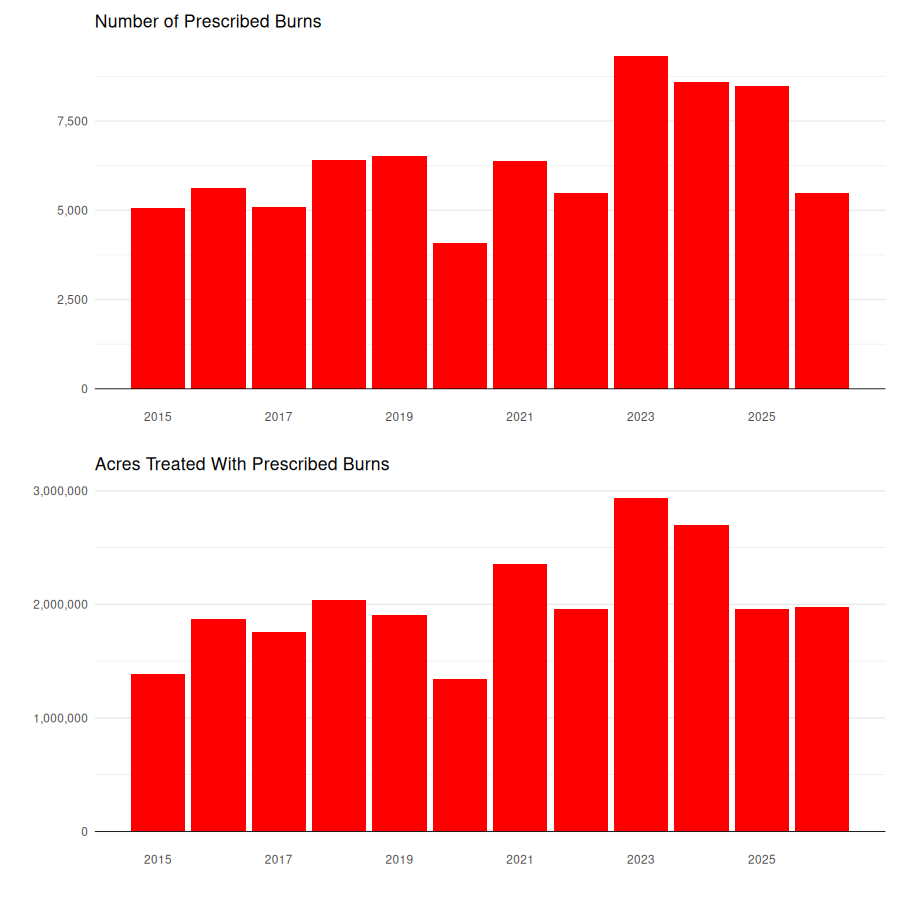
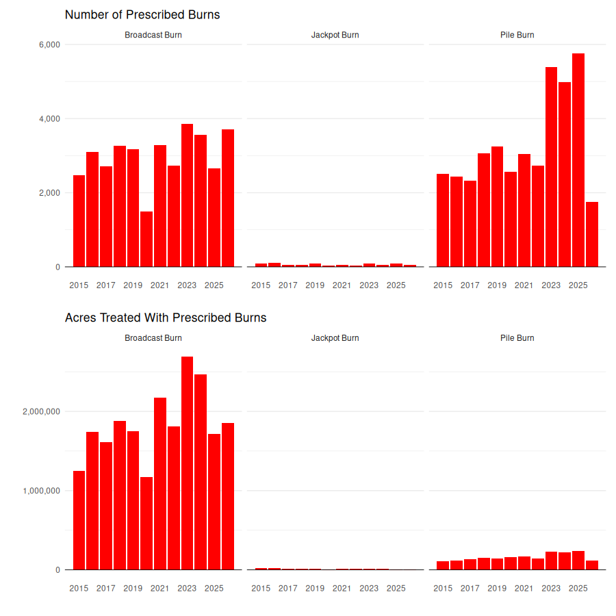
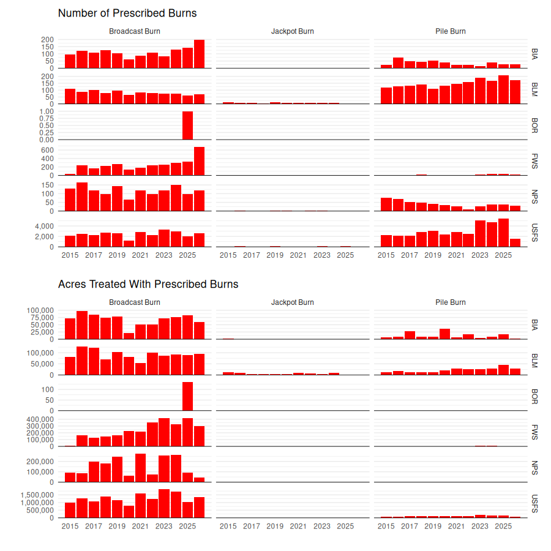

# **Analysis of Federal Prescribed Burns**

[R](https://www.r-project.org/) code to reproduce the analysis of prescribed burning to reduce wildfire risk by federal agencies, referenced in [this Nov. 17, 2026, Inside Climate News article](https://insideclimatenews.org/news/17112026/wildfire-litigation-complicating-prescribed-burns/).

### **Code/data**

The repository contains the script `federal_prescribed.R`, which analyzes [data](https://services3.arcgis.com/T4QMspbfLg3qTGWY/ArcGIS/rest/services/Integrated_Interagency_Fuels_Treatments_View/FeatureServer/0) from the federal Integrated Agency Fuels Treatments - Public dataset.

### Results

Overall, we found no evidence of a decline in federal prescribed burns in recent years, following the Hermit's Peak fire of 2022, in which a prescribed burn escaped to become the largest in New Mexico history.

The following charts show the number and acres burned by calendar year. (Note, data for 2026 is incomplete.)

#### Federal Prescribed Burns by Year

#### Federal Prescribed Burns by Year and Type

**Burn types**

**Broadcast Burn:** Prescribed burn in which a low-intensity fire is spread across a large predetermined area

**Jackpot Burn:** Prescribed burn targeting natural accumulations of fuels.

**Pile Burn:** Prescribed burn in which fuels including branches and logs are stacked into piles, which are then burned.

#### Federal Prescribed Burns by Year, Type and Agency

**Agencies**

**Department of the Interior:**

    **BIA:** Bureau of Indian Affairs

    **BLM:** Bureau of Land Management

    **BOR:** Bureau of Reclamation

    **FWS:** U.S. Fish and Wildlife Service

    **NPS:** National Park Service

**U.S. Department of Agriculture:**

    **USFS:** U.S. Forest Service

The U.S. Forest Service is the most important agency for prescribed burns. The number of pile burns conducted by the U.S. Forest Service almost doubled after the Hermit’s Peak-Calf Canyon incident, comparing 2023 to 2025 to the three years from 2020 to 2022. These burns, which can be [conducted under cooler and wetter conditions](https://psl.noaa.gov/news/2026/prescribedburns.html) after the main fire season, are generally considered less likely to get out of control. Still, they accounted for a tiny fraction of the total acres burned.

### **Questions/Feedback**

Email [Peter Aldhous](mailto:peter.aldhous@insideclimatenews.org).
